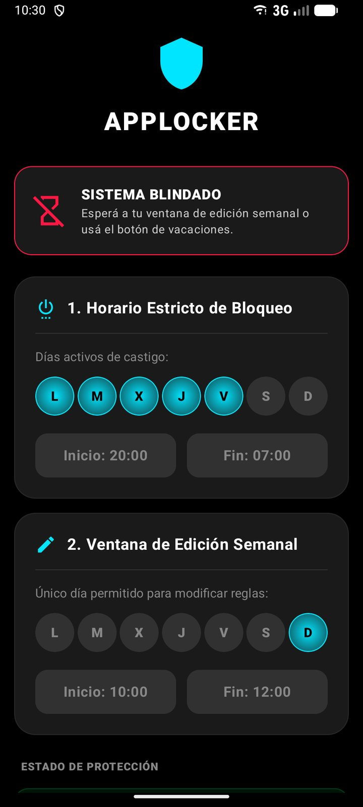
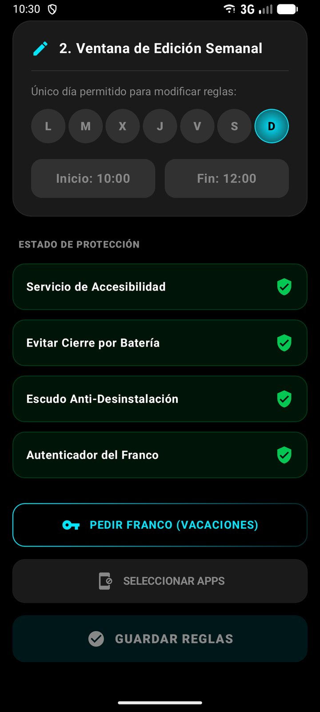
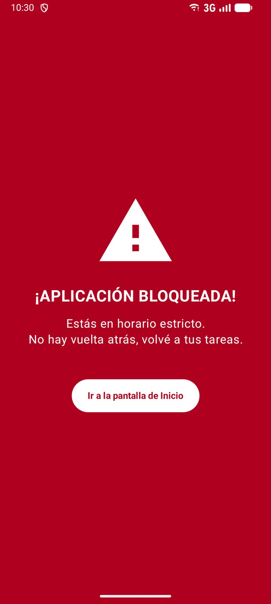
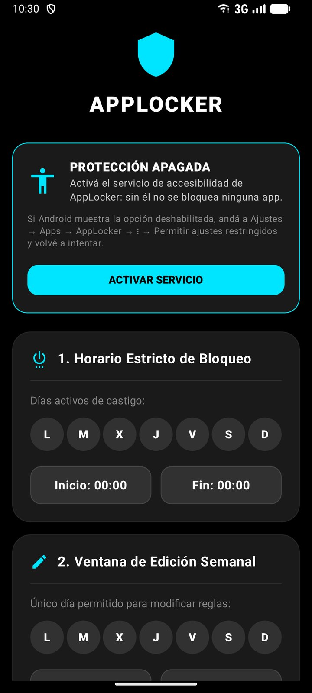
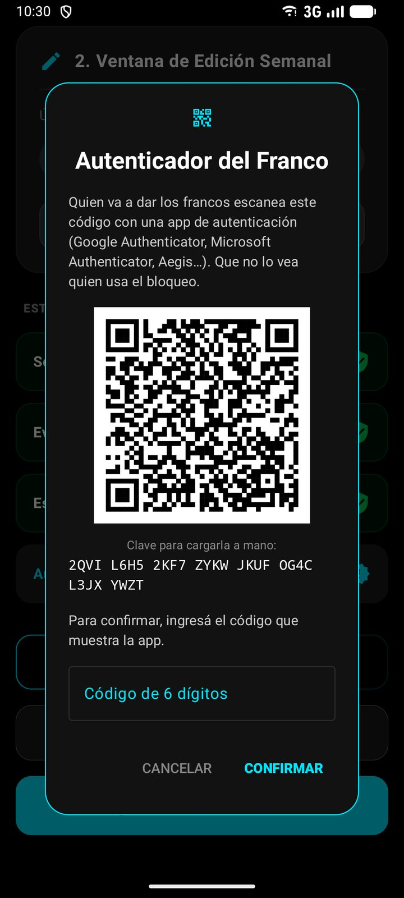
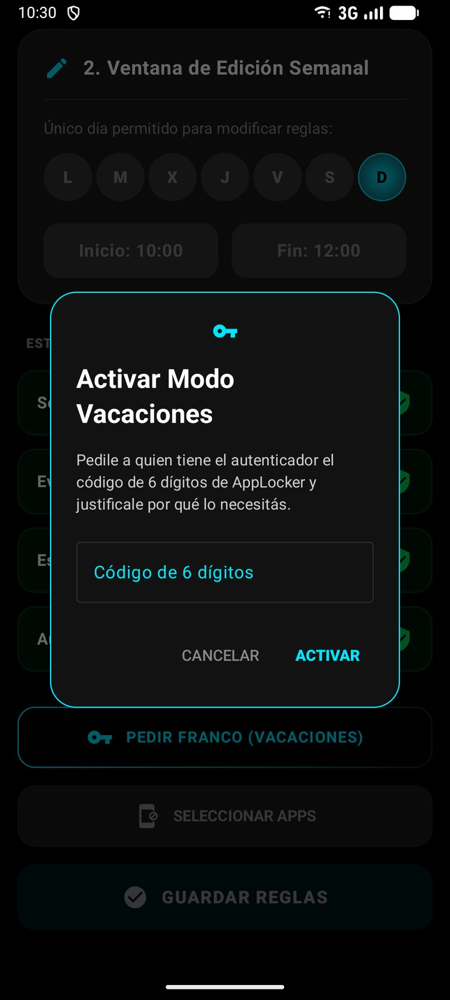

# 🔒 AppLocker

**Bloqueador de apps para Android con horario semanal y reglas difíciles de saltear.** App nativa en Kotlin y Jetpack Compose.


Bloquea las apps que elijas en los días y horarios que definas. Para que el bloqueo no se desactive en un momento de debilidad, las reglas solo se pueden cambiar en una ventana semanal o con un código de un solo uso que dicta otra persona desde su app de autenticación.

La desarrollé en marzo de 2026 para un amigo, que la usa en su Samsung Galaxy S23 Ultra (Android 16). No hay APK ni release publicado: se compila desde el código.

| Reglas activas | Estado de protección | App bloqueada |
|:---:|:---:|:---:|
|  |  |  |

| Servicio apagado | Autenticador del franco | Pedir un franco |
|:---:|:---:|:---:|
|  |  |  |

<sub>Capturas de un emulador con Android 16 (API 36). El QR corresponde a una configuración de prueba.</sub>

---

## Qué hace

- **Apps a bloquear:** se eligen de la lista de apps instaladas que tienen ícono en el launcher.
- **Horario de bloqueo:** días de la semana y una franja horaria. La franja puede cruzar la medianoche: lunes 22:00–07:00 va del lunes a las 22:00 al martes a las 07:00.
- **Pantalla de bloqueo:** si se abre una app elegida dentro del horario, se muestra encima una pantalla roja (una `Activity`). El botón Atrás no hace nada; la única salida es volver al inicio.
- **Ventana de edición semanal:** un día y una franja en los que se pueden cambiar las reglas. Fuera de ella la configuración queda de solo lectura y **Ajustes de Android también se bloquea**, para que no se pueda apagar el servicio ni quitar el administrador del dispositivo.
- **Franco:** un código TOTP de 6 dígitos habilita la edición y el acceso a Ajustes durante 24 horas. No levanta el bloqueo de las apps por sí solo: da tiempo para cambiar las reglas. Quien da los francos lo lee en su app de autenticación (Google Authenticator, Aegis, etc.), después de escanear una sola vez un QR que muestra AppLocker.
- **Onboarding:** si el servicio de accesibilidad está apagado, la app lo avisa y lleva directo a activarlo.
- **Protección opcional:** excepción de optimización de batería y administrador del dispositivo (mientras está activo, Android no deja desinstalar la app).

## Cómo funciona

```
 LockerAccessibilityService ──▶ LockPolicy.shouldBlock(paquete) ──▶ LockActivity
   (paquete en primer plano)            ▲
                                        │ Flow<LockSettings>
                              LockSettingsRepository ◀── DataStore
                                        │
                                   AppViewModel ──▶ AppUiState ──▶ pantallas Compose
```

- **`LockerAccessibilityService`** escucha solo eventos `TYPE_WINDOW_STATE_CHANGED` y lee el nombre del paquete que pasó a primer plano. No pide acceso al contenido de la pantalla.
- **`LockPolicy`** es Kotlin puro: recibe un `java.time.Clock`, así que se testea con una hora fija. Decide si las reglas se pueden editar:
  - **Regla 0:** sin días de bloqueo configurados (por ejemplo, recién instalada), todo es editable.
  - **Regla 1:** hay un franco activo.
  - **Regla 2:** es el día y la franja de la ventana de edición.

  Si no se cumple ninguna, se bloquea Ajustes (`com.android.settings` y `com.samsung.android.settings`). Aparte, las apps elegidas se bloquean mientras el horario de bloqueo esté activo.
- **`LockSettingsRepository`** envuelve a DataStore y expone toda la configuración como un único `Flow<LockSettings>`. Lo usan el servicio y el ViewModel.
- **`HolidayCodeRepository`** maneja el autenticador del franco:
  - Códigos TOTP (RFC 6238: HMAC-SHA1, 6 dígitos, pasos de 30 segundos), con un paso de tolerancia por desfasaje de reloj.
  - El secreto se genera en el teléfono, se cifra con una clave AES-GCM del Android Keystore (no se puede exportar) y se guarda en un DataStore aparte, excluido de los backups.
  - Cada código sirve una sola vez. Después de 5 intentos fallidos, los intentos se bloquean durante 30 minutos.
  - La primera configuración solo se permite mientras las reglas son editables. Para reemplazar el autenticador hace falta un código válido del actual.
- **`AppViewModel`** combina la configuración, las apps instaladas y un ticker por minuto en un `AppUiState` (`combine` + `stateIn`). Así la edición se cierra sola cuando termina la ventana aunque la app quede abierta. Antes de guardar, vuelve a validar que la edición esté permitida: no depende solo de que la UI deshabilite los botones.

```
app/src/main/java/com/jair/applocker/
├── domain/      LockPolicy, LockSettings, TimeFormat (sin dependencias de Android)
├── data/        DataStoreManager, LockSettingsRepository, AppRepository
├── services/    LockerAccessibilityService
├── receivers/   AdminReceiver, BootReceiver
├── ui/          pantallas, componentes, tema y AppViewModel
├── MainActivity.kt
└── LockActivity.kt
```

## Permisos

| Permiso o componente | Para qué se usa |
|---|---|
| Servicio de accesibilidad (`BIND_ACCESSIBILITY_SERVICE`) | Saber qué app pasa a primer plano. Se activa a mano en Ajustes → Accesibilidad. |
| `QUERY_ALL_PACKAGES` | Listar las apps instaladas para elegir cuáles bloquear. |
| `REQUEST_IGNORE_BATTERY_OPTIMIZATIONS` | Pedir que el ahorro de batería no frene la app. |
| Administrador del dispositivo (`BIND_DEVICE_ADMIN`) | Impedir la desinstalación mientras esté activo. Declara la política `force-lock`, que la app no usa. |
| `RECEIVE_BOOT_COMPLETED` | Mostrar un aviso al encender el teléfono. El servicio de accesibilidad lo vuelve a levantar Android. |

`QUERY_ALL_PACKAGES` y `REQUEST_IGNORE_BATTERY_OPTIMIZATIONS` tienen restricciones en Google Play. La app no se distribuye por Play Store.

## Compilar y probar

Requisitos: Android Studio reciente (el proyecto usa AGP 8.13) o JDK 17+ y el Android SDK 36.

```bash
git clone https://github.com/JuanEspinoza8/AppLocker.git
cd AppLocker
./gradlew test assembleDebug
```

El APK queda en `app/build/outputs/apk/debug/`. En Windows, usá `gradlew.bat`.

### Puesta en marcha en el teléfono

1. Instalá el APK desde Android Studio o con `adb install`.
2. Abrí AppLocker y tocá **ACTIVAR SERVICIO**. En Ajustes → Accesibilidad → AppLocker, activá el servicio.
   - En Android 13 o superior, las apps instaladas fuera de Play Store tienen *ajustes restringidos*: si el interruptor aparece gris, andá a Ajustes → Apps → AppLocker → ⋮ → **Permitir ajustes restringidos** y volvé a intentar.
3. Recién instalada, todo es editable (Regla 0). Elegí las apps, el horario y la ventana de edición, activá la protección de batería y el administrador, y tocá **GUARDAR REGLAS**.
4. Quien va a dar los francos toca **Autenticador del Franco**, escanea el QR con su app de autenticación y confirma con el código que le muestra. Conviene que quien usa el bloqueo no vea el QR.
5. A partir de ahí, las reglas solo se cambian dentro de la ventana de edición o con un código de franco.

### Tests

`./gradlew test` corre los tests JUnit de:

- `LockPolicy`: Regla 0, domingo = 7, límites exactos de la franja, cruce de medianoche, ventana de edición y franco activo y vencido.
- `TimeFormat`: lectura y escritura de `HH:mm`.
- `Totp` y `Base32`: vectores de prueba de RFC 6238 y RFC 4648, tolerancia de reloj y códigos ya usados.
- `AttemptLimiter` y la verificación de códigos: un código sirve una vez, 5 fallos bloquean los intentos y un secreto ilegible obliga a configurar de nuevo.
- El mapeo de las preferencias guardadas a `LockSettings`, para no romper instalaciones existentes.

## Limitaciones

- **Modo seguro:** al arrancar en modo seguro, Android desactiva los servicios de accesibilidad de terceros. Desde ahí se puede quitar el administrador y desinstalar la app.
- **Depuración USB:** con ADB se puede apagar el servicio o cambiar ajustes desde una computadora.
- **Otros fabricantes:** solo se bloquean los paquetes de Ajustes de Android y de Samsung. En otras marcas, Ajustes puede usar otro paquete.
- **Bloqueo reactivo:** la app bloqueada llega a abrirse un instante antes de que aparezca la pantalla de bloqueo.
- **Precisión de minuto:** las franjas incluyen el minuto de inicio y el de fin (09:00–17:00 bloquea hasta las 17:00:59).
- **Configuración del autenticador:** si quien usa el bloqueo ve el QR o la clave cuando se configura, puede darse francos a sí mismo.
- **Autenticador perdido:** si quien da los francos pierde su app de autenticación, durante la ventana de edición hay que desactivar el administrador del dispositivo, borrar los datos de AppLocker y volver a configurar todo.
- **Hora del teléfono:** los códigos dependen de la hora. Si la del teléfono está muy corrida, los códigos no coinciden. Para cambiar la hora hay que entrar a Ajustes, que está bloqueado fuera de la ventana de edición.
- No es una herramienta de control parental: sirve para quien quiere autolimitarse. Con suficiente insistencia (modo seguro, ADB, restablecer el teléfono) se puede saltear.

### Sobre el nombre del paquete

El `applicationId` es `com.jair.applocker`. No se cambió porque la app ya está instalada en un teléfono: con otro `applicationId`, Android la trataría como una app distinta y habría que desinstalarla y perder la configuración.

---

## Stack

<p>
  
  
  
  
  
  
  
  
  
  
  
</p>

## Autor

<a href="https://github.com/JuanEspinoza8">
  <br />
  <b>Juan Espinoza</b>
</a>

## Licencia

[MIT](LICENSE)
